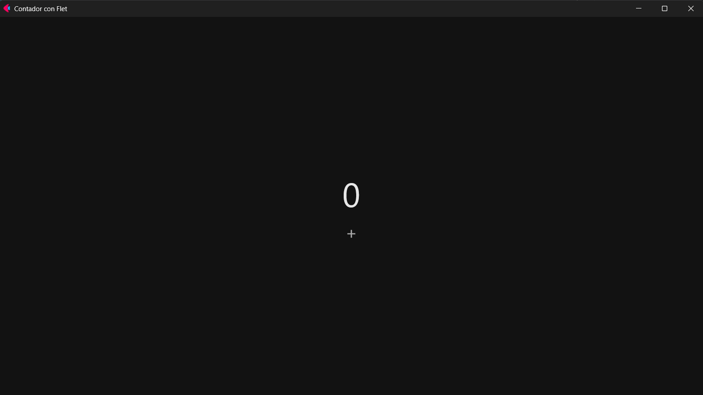
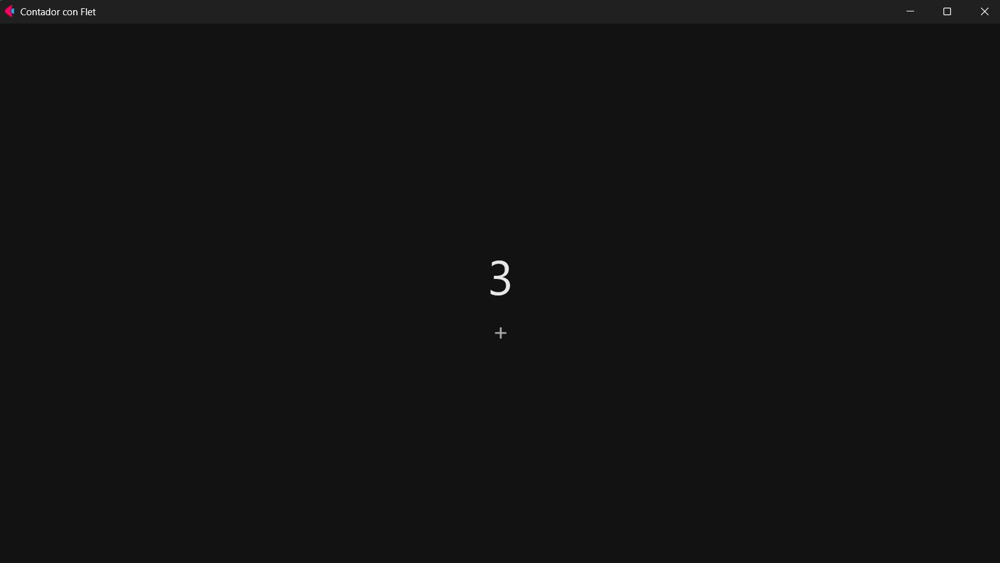
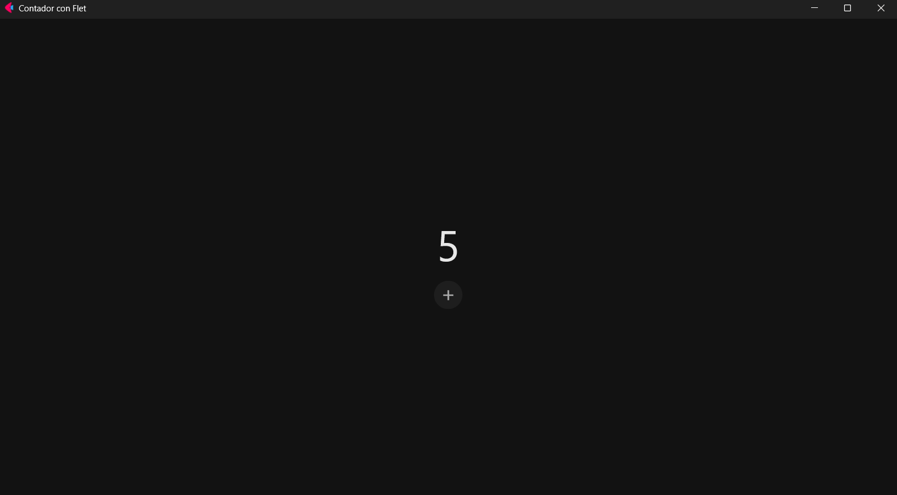

# Contador interactivo con Flet

Taller de investigación – Programación Orientada a Objetos  
Tema: Interfaces gráficas y programación orientada a eventos  
Autor: Jonny Cueto

## Biblioteca seleccionada

**Flet**: framework de Python para construir aplicaciones web, de escritorio y móviles sin necesidad de experiencia en desarrollo frontend. Sus controles están basados en Flutter, de Google.

### ¿Qué es y cuál es su propósito?
Flet permite crear interfaces gráficas usando únicamente Python. Su propósito es llegar de la idea a una aplicación interactiva con muy poco código y sin manejar HTML, JavaScript, Dart ni otras tecnologías.

### ¿Qué tipo de aplicaciones permite desarrollar?
Aplicaciones para Windows, Linux, macOS, web, iOS y Android. Es especialmente útil para herramientas internas, dashboards, formularios de captura de datos y prototipos.

### Instalación y requisitos
- Python 3.10 o superior (verificar en la documentación oficial).
- Instalación: `pip install flet`

### Principales componentes gráficos
- `Page`: ventana o pantalla principal.
- `Text`: texto.
- `TextField`: campo de entrada.
- `Button` / `IconButton`: botones.
- `Row` / `Column`: organización de elementos.
- `Dropdown`: se implementa para listas desplegables.
- `Silder`: sirve para seleccionar valores mediante una barra deslizante.

### Manejo de eventos
Cada control tiene propiedades como `on_click` u `on_change` a las que se les asigna una función. Cuando el usuario interactúa con el control, Flet ejecuta esa función y le pasa un objeto de evento (`e`). Después de modificar el control se llama a `page.update()` para refrescar la interfaz.

### Ventajas y limitaciones frente a Tkinter

| Característica | Flet | Tkinter |
|---|---|---|
| Apariencia | Moderna (Material / Flutter) | Clásica |
| Plataformas | Escritorio, web y móvil | Solo escritorio |
| Instalación | Requiere `pip install flet` | Viene incluido con Python |
| Dependencias | Externas, más pesadas | Ninguna |
| Madurez | Más joven; la API cambia entre versiones | Muy estable y con mucha documentación |

## Instalación y ejecución

1. Clonar el repositorio:
   ```bash
   git clone URL_DEL_REPOSITORIO
   cd NOMBRE_DEL_REPOSITORIO
   ```
2. (Opcional) Crear un entorno virtual:
   ```bash
   python -m venv venv
   venv\Scripts\activate        # Windows
   source venv/bin/activate     # Linux / macOS
   ```
3. Instalar las dependencias:
   ```bash
   pip install -r requirements.txt
   ```
4. Ejecutar la aplicación:
   ```bash
   flet run main.py
   ```
   También puede ejecutarse con `python main.py`. Para abrirla en el navegador: `flet run --web main.py`.

## Ejemplo desarrollado: contador interactivo

La aplicación muestra un contador que inicia en cero. Cada vez que el usuario presiona el botón "+", el contador aumenta en uno y el nuevo valor se muestra en pantalla.

### Explicación del funcionamiento

1. **Creación de la ventana:** `ft.run(main)` abre la ventana y envía a la función `main` un objeto `page`, que representa la pantalla principal. Con él se configura el título y la alineación.
2. **Creación de los componentes:** se crean un `ft.Text` (muestra el número) y un `ft.IconButton` (el botón "+"). Se muestran en pantalla con `page.add(...)`.
3. **Evento implementado:** el clic del usuario sobre el botón, detectado mediante la propiedad `on_click=incrementar`.
4. **Función que responde al evento:** `incrementar(e)`.
5. **Modificación de la interfaz:** la función suma 1 al contador, actualiza el valor de `texto.value` y llama a `page.update()` para que el cambio se vea en pantalla.

## Evidencia





## Fuentes consultadas
- https://flet.dev/
- https://www.pythonguis.com/tutorials/getting-started-flet/
- https://labdeck.com/flet-tutorial/
